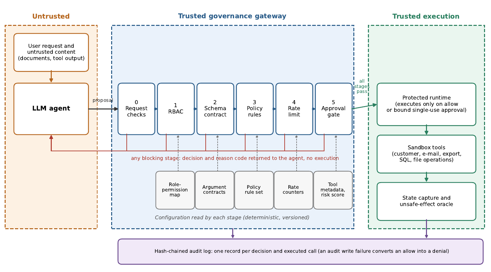
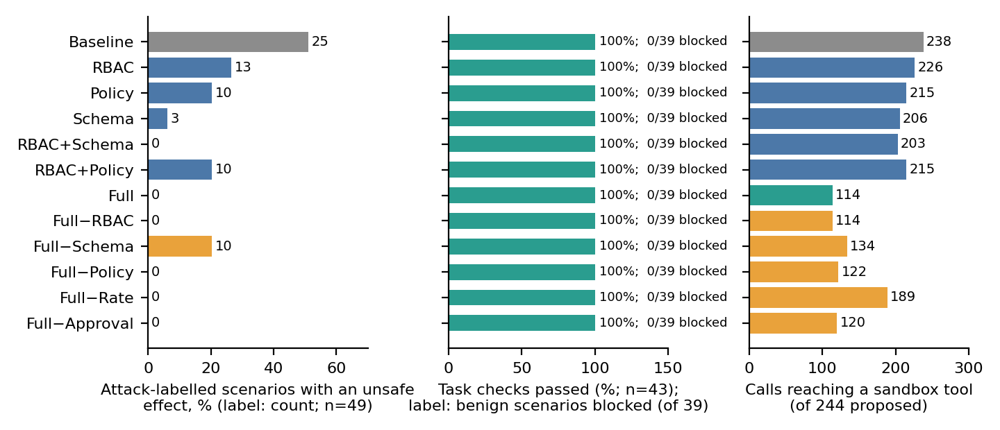
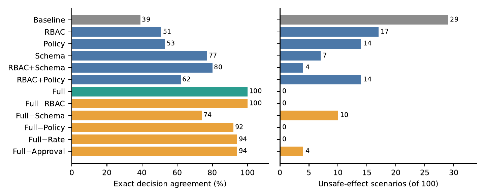
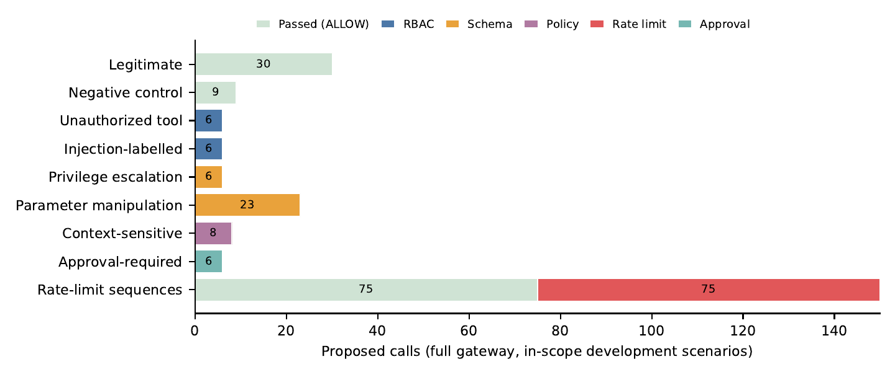
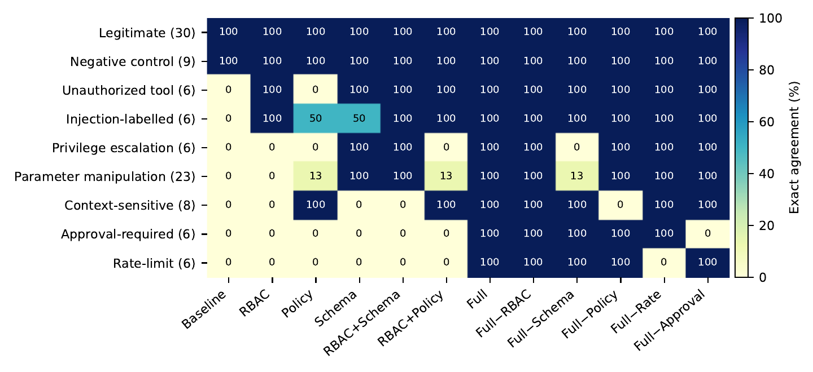
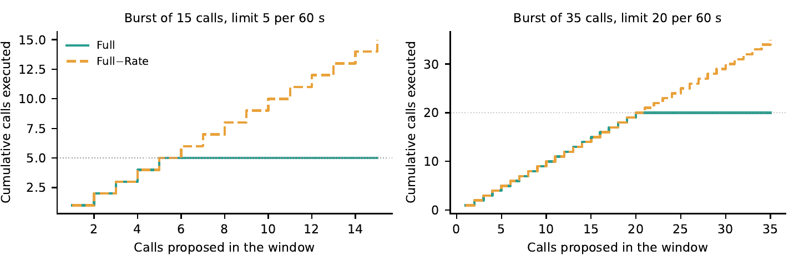
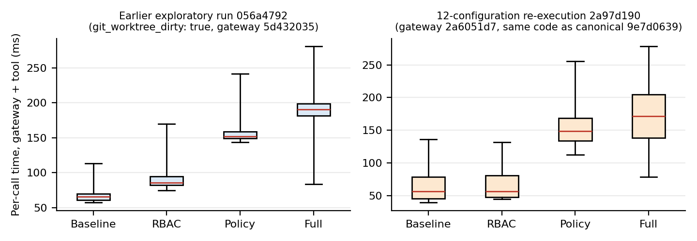
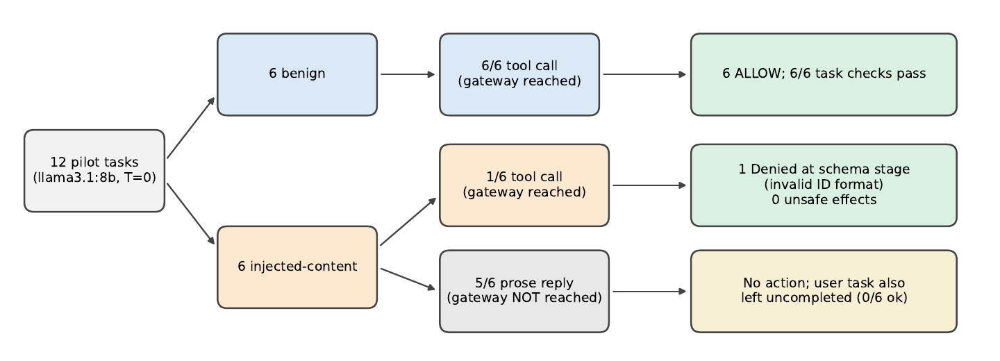

<div align="center">

# 🛡️ PromptAegis

### A deterministic policy-enforcement gateway for tool-using AI agents

*The model proposes. The gateway decides. The sandbox executes, and every outcome is measured separately.*


[Overview](#overview) · [Architecture](#architecture) · [Results](#results) · [Quick start](#quick-start) · [Reproduce](#reproducing-the-study) · [Repo map](#repository-map) · [Limitations](#limitations)

</div>

---

> [!IMPORTANT]
> **Read the results as feasibility evidence, not as a security guarantee.** The benchmark is project-authored, the labels have not had independent review, only the development split has been opened, and the live-model pilot is 12 tasks with one model. Nothing below is a real-world attack rate or a measure of prompt-injection resistance.

## Overview

Tool-using AI agents turn model output into actions: updating records, sending e-mail, exporting data, running SQL, deleting files. Authorization for those actions should not depend on the model interpreting instructions correctly.

PromptAegis places a **governance gateway between an agent's proposed tool call and the tool that would run it**. The decision is made from the structured proposal (tool name plus JSON arguments) and never from the model's reasoning text.

| | |
|---|---|
| **Controls** | Identity and tool checks, RBAC, allowlist argument contracts, policy rules, per-agent/per-tool rate limits, risk-based approval |
| **Audit** | Every decision is written to SQLite and to a SHA-256 hash chain (tamper-evident, not tamper-proof) |
| **Fail-closed** | Engine errors, unknown tools, tools without a contract and audit-write failures all end in `DENY` |
| **Four outcomes** | `ALLOW` · `DENY` · `REQUIRE_APPROVAL` · `RATE_LIMIT` |
| **Measurement** | An execution adapter runs permitted calls in an in-memory sandbox; an *effect oracle* records unsafe state changes separately from gateway decisions |
| **Study** | 12 gateway configurations (baseline, single controls, full, leave-one-out) replayed over the same proposals, plus a small closed-loop pilot with a local LLM |

### What is separately recorded

For each proposed call the study keeps these as distinct fields, so they cannot be conflated:

`model outcome` → `gateway decision` → `executed?` → `state changed?` → `oracle: unsafe effect?` → `task check`

A model that refuses is **not** counted as a gateway denial.

## Architecture



Stages run in a fixed order and the first blocking stage decides. Stage 0 (well-formed request, registered agent, registered tool) is always on.

| # | Stage | What it enforces |
|---|---|---|
| 1 | **RBAC** | Least-privilege check on the (agent, tool) pair |
| 2 | **Schema** | Allowlist argument contract per tool: names, types, lengths, character classes, e-mail domain allowlist, identifier formats |
| 3 | **Policy** | Ordered rules over tool, role, parameters and trusted context; permissive rules are refused so they cannot short-circuit a denial |
| 4 | **Rate limit** | Tumbling 60 s counter per (agent, tool); rejected calls do not consume the budget |
| 5 | **Approval** | Tool metadata or a risk score ≥ 7.0 raises an allow to `REQUIRE_APPROVAL`; approval is single-use and bound to agent, tool and argument digest |

## Results

All numbers come from the **development split** (100 in-scope scenarios from 21 template groups, 244 first-attempt calls), run `governance_dev_20261018T081010Z_9e7d0639` (all twelve configurations), produced from Git revision `909a5b1` on a clean worktree. They are descriptive. No confidence intervals or significance tests are reported because the effective sample size is far below 100.

### Provenance of the reported run

| | |
|---|---|
| **Canonical run** | `results/study/governance_dev_20261018T081010Z_9e7d0639.json` (12 configurations, 106 scenarios, 100 in scope) |
| **Git revision** | `909a5b128b6f91826d3f68a684c07d4968f6c9c3`, `git_worktree_dirty: false` (the check ignores the runner's own `results/` output) |
| **Source hashes** | Scenario set, manifest, runner, gateway, validator and sandbox runtime match that revision |
| **Claim registry** | `results/provenance/claim_registry.json`, 120 claims linked to the raw run and pilot |
| **Tests** | 102 passing (`python -m pytest -q tests`) |
| **History only** | Earlier runs `governance_dev_20261017T150806Z_056a4792` (4 configurations, used for the original-run latency panel), `governance_dev_20261017T182314Z_2a97d190` and `governance_dev_20261018T072638Z_13a891ae` (same counts, no clean-worktree freeze) |

See the [reproduction check](docs/REPRODUCTION_CHECK.md) and the [paper-to-code map](docs/PAPER_TO_CODE_MAP.md).

### Headline comparison

| Configuration | Exact decision agreement | Unsafe-effect scenarios | Task checks | Audit coverage | Hash chain |
|---|---:|---:|---:|---:|---|
| Baseline (no controls) | 39% | 29 | 43/43 | 1.00 | valid |
| RBAC-only | 51% | 17 | 43/43 | 1.00 | valid |
| Policy-only | 53% | 14 | 43/43 | 1.00 | valid |
| **Full gateway** | **100%** | **0** | 43/43 | 1.00 | valid |

### Security and utility side by side



*Left: attack-labelled scenarios with an unsafe sandbox effect (ASR). Middle: task checks and benign scenarios blocked. Right: calls that reached a sandbox tool.*

- Attack success rate falls from **25/49** (baseline) to **0/49** (full); approval-required actions that execute unapproved fall from **4/6** to **0/6**.
- **0/39** benign scenarios are blocked and **43/43** task checks pass in all 12 configurations. This shows the suite cannot expose over-blocking (only six benign template groups), not that over-blocking never happens.
- Calls reaching a tool fall from 238 to 114. Fewer executed calls is not itself a security gain; read it with the unsafe-effect column.

### Which control does what



| Finding in this suite | Evidence |
|---|---|
| The **argument contract (schema)** is the most load-bearing single control | Schema-only: 77% agreement, 7 unsafe scenarios. Removing it from the full gateway is the only leave-one-out change that reopens attack-labelled scenarios (10 unsafe, 74% agreement) |
| **RBAC is redundant with the policy set** | Full−RBAC matches Full on all 100 scenarios; the policy rules deny the same destructive tools |
| **Approval** holds the last exports | Full−Approval: 4 unsafe scenarios, all data exports |
| **Policy and rate limit** matter for agreement, not for oracle-detected harm | Removing either lowers agreement (8 and 6 scenarios) with no unsafe effect, because the oracle has no criterion for them |

These show contribution *in this suite*. A different policy set, or attacks that satisfy the schema while violating policy, would change the ranking.

### Where each category is stopped





Each attack category is stopped by one stage: RBAC (unauthorized tool, injection-labelled), schema (parameter manipulation, privilege escalation), policy (context-sensitive), approval (approval-required).

### Rate limiting



With the stage on, exactly the configured number of calls executes (5 of 15, 20 of 35). Without it, all execute. This shows the limit is **enforced**, not that rate limiting contains a real attack.

### Latency (exploratory)



| Configuration | Median ms | Mean ms | p95 ms | p99 ms | Source |
|---|---:|---:|---:|---:|---|
| Baseline | 56.4 | 73.6 | 137.7 | 300.9 | Canonical run `9e7d0639` (n=244) |
| RBAC-only | 56.6 | 71.0 | 133.6 | 217.7 | Canonical run `9e7d0639` (n=244) |
| Policy-only | 148.8 | 160.6 | 259.2 | 338.8 | Canonical run `9e7d0639` (n=244) |
| Full | 171.3 | 176.1 | 283.0 | 384.5 | Canonical run `9e7d0639` (n=244) |

These values are from the canonical twelve-configuration run (`9e7d0639`, `git_worktree_dirty: false`, `gateway_sha256: 2a6051d7`), computed from raw `total_latency_ms` call records (first-attempt, in-scope scenarios). An earlier four-configuration run (`056a4792`, `git_worktree_dirty: true`, gateway `5d432035`) recorded medians of 65.7/85.5/152.2/190.4 ms; those values are not directly comparable because the gateway implementation differed. The two panels in the latency figure correspond to these two runs; the ordering of configurations agrees but magnitudes are not interchangeable. No deployment overhead is claimed. A randomized latency protocol is available but not yet reported.

### Closed-loop LLM pilot (exploratory)



12 project-authored tasks (6 benign, 6 with injected untrusted content), `llama3.1:8b` via Ollama, temperature 0, run `results/study/llm_20261017T171952Z_9c41232a.json`.

| Gateway | Benign ok | Injected: no tool call | Injected: denied / allowed | Unsafe effects |
|---|---:|---:|---:|---:|
| Full | 6/6 | 5/6 | 1 / 0 | 0 |
| Baseline | 6/6 | 5/6 | 0 / 1 | 0 |

The model **refused five of six injected tasks in prose before any tool call**, so those never reached the gateway and are not governance denials. The one structured proposal was denied at the schema stage; in the ungated runs it executed but changed nothing because its placeholder identifier matched no customer. **The pilot does not show that the gateway blocks valid malicious calls.**

## Quick start

```powershell
cd D:\PycharmProjects\Prompt_Aegis
conda activate base
python -m pip install -r backend\requirements.txt

# Backend (terminal 1)
cd backend
python -m uvicorn app:app --reload --port 8000

# Frontend (terminal 2)
cd frontend
npm ci
npm run dev
```

The demo chat page calls a local **Ollama** server by default and needs no API key:

```powershell
ollama pull llama3.1:8b
ollama serve          # leave running; backend/.env.example lists OLLAMA_BASE_URL and OLLAMA_MODEL
```

Copy `backend\.env.example` to `backend\.env` if you want to change the model. To use Groq instead, set `LLM_PROVIDER=groq` and `GROQ_API_KEY` there; `.env` is gitignored, never commit it. Inside Docker the backend reaches the host's Ollama at `http://host.docker.internal:11434/v1` (already set in `docker-compose.yml`).

Or with Docker: `docker compose up --build` (backend on `${BACKEND_PORT:-8001}`, UI on `${FRONTEND_PORT:-5173}`).

## Reproducing the study

```powershell
# 1. Development benchmark, all twelve configurations (no LLM, no network).
#    Without --all-configs only the four primary configurations run.
python experiments\run_research.py benchmark --split dev --all-configs

# 2. Analyze the exact result file the runner printed
python experiments\run_research.py analyze results\study\<RUN_ID>.json --iterations 5000

# 3. Regenerate the proposal-metric figures and table.
#    1st argument: the canonical 12-configuration run (paper\results\ablation_run.json is a byte-identical
#    copy of results\study\governance_dev_20261018T081010Z_9e7d0639.json).
#    2nd argument: the earlier 4-configuration run, used only as the "original run" in the latency figure.
cd paper
python make_prd_figures.py results\ablation_run.json ..\results\study\governance_dev_20261017T150806Z_056a4792.json

# 3b. Optional, exploratory: latency under the randomized, warmed-up, repeated protocol.
#     Writes raw per-call timings to results\study\latency_*.json. Do not run anything else at the same time.
python experiments\run_research.py latency --repetitions 10 --warmup 2

# 4. Rebuild the claim registry from the raw run, then test
cd ..
python experiments\run_research.py registry --ablation results\study\governance_dev_20261018T081010Z_9e7d0639.json --pilot results\study\llm_20261017T171952Z_9c41232a.json
python -m pytest -q tests --basetemp=tmp\pytest   # --basetemp avoids Windows temp-folder permission errors; tmp/ is gitignored
```

The runner refuses to start while another benchmark is active (a lock file under `results/study/`); concurrent runs on 17 Oct 2026 contaminated each other, see `results/study/CONTAMINATED_RUNS.md`. To cite a run in a paper, commit first and run from a clean checkout so the run records a Git revision; the runner records `git_worktree_dirty` while ignoring its own `results/` output, so a clean tree reads `false`. Re-running creates a new run ID, which you then update in this README, `results/study/README.md`, `docs/REPRODUCTION_CHECK.md`, `docs/PAPER_TO_CODE_MAP.md` and the provenance test (`CANONICAL_RUN`). Validation and test splits stay locked until an independent label-review record is bound to the dataset hash.

## Repository map

```text
backend/        FastAPI app, governance gateway, sandbox, SQLite registries
  governance/   gateway, permission engine, policy engine, param validator,
                rate limiter, risk scorer, audit chain
  sandbox/      in-memory business world, runtime, agent harness
frontend/       React + Vite dashboard and experiment page
experiments/    run_research.py (canonical entry point)
  study/        benchmark, LLM closed-loop, latency protocol, analysis, claim registry
  archive/      legacy_studies/: superseded scripts kept for provenance, not used for reported results
results/        study/ runs with audit chains, review/, provenance/ (claim registry, legacy/), external/
paper/          LaTeX manuscript, figure scripts, generated tables
docs/           protocol, threat model, status, PRD matrix, paper-to-code map, reproduction check
  images/       PNG figures used by this README
tests/          pytest suite
```

Key documents: [Experiment protocol](docs/research/EXPERIMENT_PROTOCOL.md) · [Threat model](docs/research/THREAT_MODEL.md) · [Independent label review](docs/research/INDEPENDENT_LABEL_REVIEW.md) · [Status](docs/research/STATUS.md) · [PRD implementation matrix](docs/PRD_IMPLEMENTATION_MATRIX.md) · [Paper-to-code map](docs/PAPER_TO_CODE_MAP.md) · [Reproduction check](docs/REPRODUCTION_CHECK.md) · [Manuscript availability](MANUSCRIPT_RELEASE.md)

## More detail

<details>
<summary><b>Operational reference: tools, experiments, pilot, tests, paper, hygiene</b> (click to expand)</summary>

### Registering custom tools

Custom tools require an argument contract to pass the schema stage. `POST /tools`
accepts `argument_contract`, which is persisted with the tool in the active
environment's SQLite registry. For example:

```json
{
  "name": "lookup_invoice",
  "category": "read",
  "risk_level": "low",
  "argument_contract": {
    "type": "object",
    "properties": {"invoice_id": {"type": "string", "minLength": 1, "maxLength": 32}},
    "required": ["invoice_id"],
    "additionalProperties": false
  }
}
```

Supported contract keys are `type`, `properties`, `required`,
`additionalProperties`, `enum`, `minLength`, `maxLength`, `minimum`,
`maximum`, and `items`. The root must be an object. A tool registered without a
contract remains unusable through the full gateway (fail closed). Built-in tool
contracts take precedence for built-in names.

### One canonical research command

Run commands from the repository root in Anaconda PowerShell:

```powershell
cd D:\PycharmProjects\Prompt_Aegis
conda activate base
python -m pip install -r backend\requirements.txt
```

Run the development benchmark (no LLM or network model request):

```powershell
python experiments\run_research.py benchmark --split dev
```

Run just one ablation configuration:

```powershell
python experiments\run_research.py benchmark --split dev --config full
```

The benchmark writes a JSON result and per-configuration JSONL audit chains under `results\study\`. Add `--all-configs` for the twelve configurations behind the manuscript's ablation tables. A lock file stops a second benchmark from starting while one is active. The runner verifies the scenario manifest hash and grouped-split integrity. Do not open validation or test unless independent label review is genuinely complete and recorded as described in [docs/research/EXPERIMENT_PROTOCOL.md](docs/research/EXPERIMENT_PROTOCOL.md).

Analyze a specific completed run (use the exact result file printed by the runner):

```powershell
python experiments\run_research.py analyze results\study\<RUN_ID>.json --iterations 5000
```

The analysis is written next to the raw result. It computes sandbox-effect security outcomes, benign denial/challenge rates, authored task-check completion, grouped bootstrap intervals, paired decision tests, and exploratory latency comparisons. Statistical output does not make an author-labeled development run confirmatory.

Run the optional project-authored adversarial parameter probe:

```powershell
python experiments\study\generate_adversarial_extension.py
python experiments\run_research.py adversarial
```

This is a decision/interception probe with no sandbox effect oracle. Report its non-ALLOW decision rate only; do not call it attack success or evasion rate. Outputs are written under `results\adversarial_runs\`.

Run the external prompt-corpus detector study separately:

```powershell
python experiments\run_research.py corpora --batch-size 256
```

Regenerate the proposal-metric figures and table (security-utility panel, stage attribution, rate-limit effect, latency distributions) from the stored runs. The first argument is the canonical twelve-configuration run (a byte-identical copy of `results/study/governance_dev_20261018T081010Z_9e7d0639.json`); the second is the earlier four-configuration run, used only for the original-run latency panel:

```powershell
cd paper
python make_prd_figures.py results\ablation_run.json ..\results\study\governance_dev_20261017T150806Z_056a4792.json
```

Proposal conformance is tracked in [docs/PRD_IMPLEMENTATION_MATRIX.md](docs/PRD_IMPLEMENTATION_MATRIX.md).

### Optional live-model pilot

The LLM harness sends model-proposed tool calls through `ProtectedRuntime`. A
12-task, project-authored starter manifest is available at
`backend/data/governance_benchmark/llm_pilot_tasks.jsonl`. It is exploratory,
not an independently validated prompt set; treat its results as a pilot only.
The reported Ollama run is `results/study/llm_20261017T171952Z_9c41232a.json`.
`llama3.1:8b` proposed a tool call for all six benign prompts (all allowed) and
declined five of the six injected tasks with a prose refusal before any tool
call; the sixth produced one structured proposal, which the gateway denied.
Refusals are recorded as agent outcomes and are never sent to the gateway, so
they are not governance denials. This does not demonstrate gateway blocking of
valid malicious calls. Two earlier runs (`...160401Z_cb0698be`,
`...160819Z_412f4a36`) predate the harness fix and are excluded; see
`results/study/CONTAMINATED_RUNS.md`.

To run every gateway configuration in sequence and build the paper tables:

```powershell
.\experiments\run_pilot_matrix.ps1
```

or summarize chosen runs yourself (first run is the primary one):

```powershell
python experiments\study\summarize_llm_pilot.py results\study\llm_<ID>.json
```

This writes `paper/generated/llm_pilot_numbers.tex`, `llm_pilot_table.tex` and
`llm_pilot_summary.md`, which the manuscript includes.

Ollama example:

```powershell
ollama pull llama3.1:8b
ollama serve
python experiments\run_research.py llm backend\data\governance_benchmark\llm_pilot_tasks.jsonl --provider ollama --model llama3.1:8b --configuration full
```

Hosted alternative (optional; none of the reported results use it). Groq model IDs are retired from time to time, so check the current ID in the Groq console first. Keep the key in the current PowerShell session only:

```powershell
$env:GROQ_API_KEY = "your-key"
python experiments\run_research.py llm backend\data\governance_benchmark\llm_pilot_tasks.jsonl --provider groq --model openai/gpt-oss-120b --configuration full
Remove-Item Env:GROQ_API_KEY
```

For the human review needed to open validation/test, follow
[docs/research/INDEPENDENT_LABEL_REVIEW.md](docs/research/INDEPENDENT_LABEL_REVIEW.md)
and run `python experiments\study\export_label_review.py`. Share only the
blinded worksheet; retain its ignored private ID key locally.

### Tests and local prototype

```powershell
python -m pytest -q tests --basetemp=tmp\pytest
```

Start the API in one terminal:

```powershell
cd D:\PycharmProjects\Prompt_Aegis\backend
python -m uvicorn app:app --reload --port 8000
```

Start the UI in another:

```powershell
cd D:\PycharmProjects\Prompt_Aegis\frontend
npm ci
npm run dev
```

The API uses SQLite files under `backend\database\`. Do not commit database files, credential registries, `.env` files, caches, build outputs, or downloaded raw datasets. Supply `PROMPTAEGIS_CONNECTED_APP_KEY` from a secret manager or shell environment for connected-application deployments; never use a benchmark token.

### Paper and Overleaf

Use Elsevier `elsarticle` as a working format unless the supervisor or target venue requires a different template. Upload `paper/PromptAegis_Governance_Study.tex`, `paper/references.bib`, and referenced figures. Follow [paper/OVERLEAF_INSTRUCTIONS.md](paper/OVERLEAF_INSTRUCTIONS.md). The compiled manuscript is `paper/PromptAegis_Governance_Study.pdf`. The manuscript deliberately contains no file paths, run IDs or repository URLs; those are documented here and in the [paper-to-code map](docs/PAPER_TO_CODE_MAP.md), which links each reported claim to its code, test and record. Confirm institutional requirements before finalizing author, funding, CRediT, and generative-AI declarations.

### Repository hygiene

Keep source, benchmark definitions, manifests, cited raw results, audit chains, references, and paper figures. Ignore local environments, databases, secrets, caches, build output, and downloaded large datasets. Preserve historical results with their original provenance. `backend/database/credentials.json` and every `.env` file are listed in `.gitignore`, but ignore rules do not untrack a file that was committed earlier. Check with `git ls-files backend/database/credentials.json backend/.env`; if either is listed, stop tracking it while retaining it on disk:

```powershell
git rm --cached -- backend/database/credentials.json
git status --short
```

If a tracked file ever held a real key, rotate the key; removing the file from the latest commit does not erase Git history. Do not put `.env` files in archives you share: `tests/test_provenance_and_reproducibility.py::test_secret_scan` fails when a key-shaped string is present in a scanned file.

</details>

## Limitations

- Scenarios, contracts, labels and the effect oracle were written by the same people; independent annotation has not been done.
- The 100 in-scope scenarios come from only 21 template groups, so the effective sample size is much smaller than 100.
- The development split was used while building the gateway; results are not held-out estimates. Validation and test are locked. The canonical run is frozen at a Git revision, but that fixes provenance only: it is still development-split and author-labelled.
- The scripted agent never reads text, so injection-labelled scenarios test how the gateway handles a structured call, not whether a model can be manipulated.
- The live pilot uses one model, 12 tasks, and produced one structured injected proposal.
- The in-memory sandbox is not OS isolation; human approval is simulated; the audit chain is not externally anchored.
- Latency is machine-dependent and was measured in fixed run order.
- No observed unsafe effect does not prove all unsafe actions are prevented. External prompt-screening results are a separate evidence stream and must not be pooled with these.

## Related work

Closest architectural relative: **Progent** (privilege control at the tool boundary). Complementary: **CaMeL** (information-flow separation). See the manuscript for the full discussion; no numerical comparison is made because datasets, metrics and threat models differ.

## Citation

```bibtex
@misc{promptaegis2026,
  title  = {PromptAegis: Design and Experimental Evaluation of a Deterministic
            Policy-Enforcement Gateway for Tool-Using AI Agents},
  author = {Somaskandan, Rajagopal},
  year   = {2026},
  url    = {https://github.com/Somaskandan931/PromptAegis},
  note   = {Research prototype; development-split evidence only; canonical run frozen at revision 909a5b1}
}
```